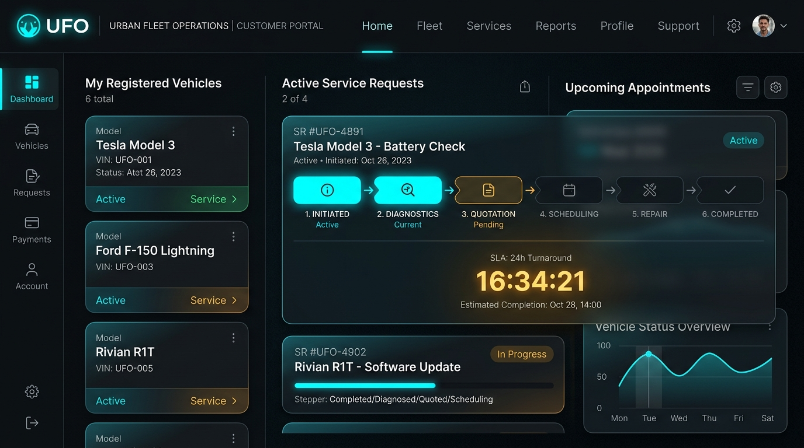
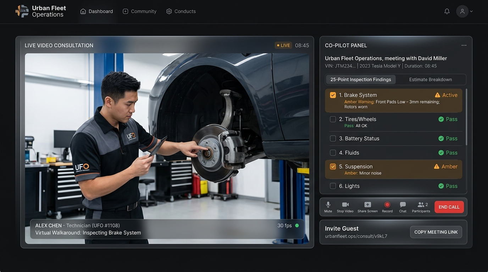
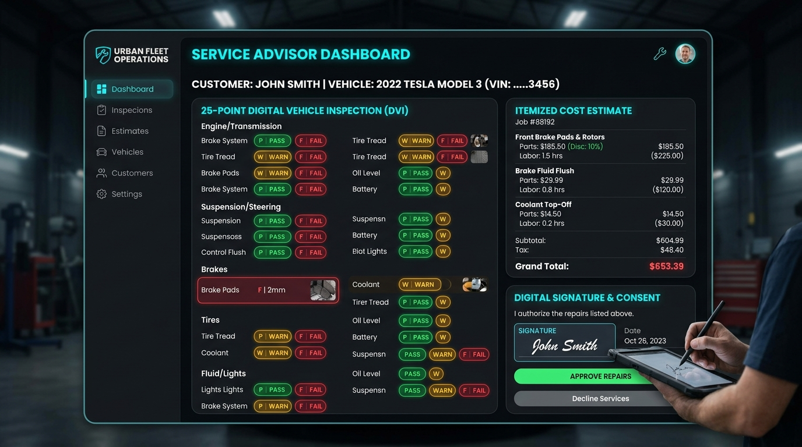
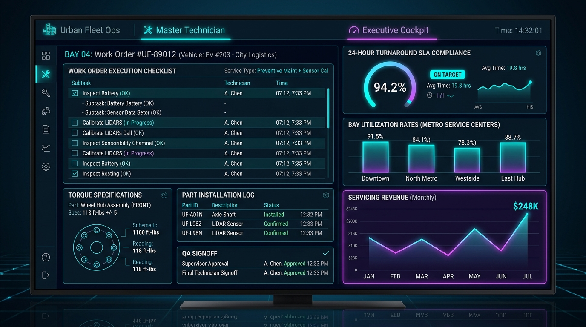

# 🚗 Urban Fleet Operations — Vehicle Service Management Platform

An enterprise-grade **MERN stack** (MongoDB, Express.js, React.js, Node.js) web application designed for **Urban Fleet Operations** to eliminate operational bottlenecks in vehicle servicing. 

The system implements the **Pega Case Lifecycle** architecture to manage end-to-end vehicle service requests from customer intake to vehicle delivery and invoice settlement.

---

## 🎬 Working UI Showcase & Live Video Consultation

### 📹 Live WebRTC Video Consultation Rooms
Direct meeting links connecting fleet vehicle owners with Service Advisors and Master Technicians for real-time visual vehicle inspections and estimate walkthroughs:
- 🔴 **Active Video Walkaround (Case SR-2026-003 — 2023 Tesla Model Y):** [Join Live Consultation Room](https://meet.jit.si/UrbanFleet-SR2026003-live#config.prejoinPageEnabled=false&config.disableDeepLinking=true) (Room PIN: `748291`)
- 📁 **Archived Session (Case SR-2026-002 — 2022 Ford F-150 Lightning):** [View Consultation Room](https://meet.jit.si/UrbanFleet-SR2026002-arch#config.prejoinPageEnabled=false&config.disableDeepLinking=true) (Room PIN: `394821`)

### 📸 Application Interface Previews

| Customer Case Lifecycle & Live SLA Countdown | Live WebRTC Video Walkaround & Co-Pilot |
|:---:|:---:|
|  |  |

| 25-Point Digital Vehicle Inspection & Estimate | Technician Bay Workbench & Executive Cockpit |
|:---:|:---:|
|  |  |

---

## 🌟 Key Business Objectives Achieved

1. **Customer Service Intake:** Customers can book service appointments, select from registered fleet vehicles, pick preferred service hubs, and specify symptoms online.
2. **25-Point Digital Vehicle Inspection:** Service advisors inspect vehicles across braking, tires, powertrain, electrical, and cabin systems with interactive Pass / Warn / Fail ratings.
3. **Itemized Cost Estimates & Digital Approval:** Dynamic calculation of parts, labor hours, diagnostics, promo discounts, and environmental compliance taxes with digital signature approval.
4. **Technician Bay Dispatch & Work Order Execution:** Automated assignment of work orders to certified bay technicians with live execution checklists.
5. **Automated Completion Alerts & Invoice Generation:** Automated notifications dispatched upon service completion with downloadable, printable tax receipts.
6. **Executive Fleet Cockpit:** Real-time SLA compliance tracking (24h turnaround target), bay utilization across service centers, and servicing revenue analytics.
7. **Live Video Consultation & Virtual Walkarounds:** Integrated WebRTC / Jitsi video consultation meeting links connecting vehicle owners with service advisors for live visual vehicle inspections and real-time estimate walkthroughs.

---

## 🏗️ Project Architecture & Directory Structure

```
c:/Project/vechicle/
├── server/                                # Node.js & Express.js Backend
│   ├── config/
│   │   └── db.js                          # MongoDB Mongoose connector with resilient fallback
│   ├── controllers/
│   │   ├── authController.js              # Authentication & persona management
│   │   ├── vehicleController.js           # Fleet vehicle registration & telemetry
│   │   ├── serviceController.js           # Core Pega Case Lifecycle & SLA engine
│   │   ├── inspectionController.js        # 25-Point digital vehicle inspection
│   │   ├── estimateController.js          # Itemized quotation & customer approval
│   │   └── notificationController.js      # Automated alert dispatch & tracking
│   ├── middleware/
│   │   └── authMiddleware.js              # JWT & role-based access control
│   ├── models/
│   │   ├── User.js                        # Customer, Advisor, Technician, Admin schemas
│   │   ├── Vehicle.js                     # Fleet vehicle & telemetry schema
│   │   ├── ServiceCenter.js               # Service center hub & bay capacity schema
│   │   ├── ServiceRequest.js              # Central Case Object & timeline history
│   │   ├── Inspection.js                  # Multi-point inspection checklist schema
│   │   ├── Estimate.js                    # Quotation, taxes, and digital consent schema
│   │   └── Notification.js                # System event notifications schema
│   ├── routes/
│   │   ├── authRoutes.js                  # /api/auth
│   │   ├── vehicleRoutes.js               # /api/vehicles
│   │   ├── serviceRoutes.js               # /api/services
│   │   ├── inspectionRoutes.js            # /api/inspections
│   │   ├── estimateRoutes.js              # /api/estimates
│   │   └── notificationRoutes.js          # /api/notifications
│   ├── utils/
│   │   └── dataStore.js                   # Unified in-memory & file-backed store
│   ├── .env                               # Port & DB configuration
│   ├── package.json
│   └── server.js                          # Express app entrypoint (Port 5001)
│
├── client/                                # React.js + Vite Frontend
│   ├── src/
│   │   ├── components/
│   │   │   ├── Navbar.jsx                 # Brand header, Persona switcher, Alerts dropdown
│   │   │   ├── CaseLifecycleStepper.jsx   # Visual Pega 6-Stage stepper & SLA countdown
│   │   │   ├── ServiceRequestModal.jsx    # Step-by-step service booking wizard
│   │   │   ├── InspectionModal.jsx        # Digital 25-point vehicle inspection modal
│   │   │   ├── EstimateModal.jsx          # Itemized estimate builder modal
│   │   │   ├── EstimateApprovalModal.jsx  # Customer approval & digital signature modal
│   │   │   ├── InvoiceModal.jsx           # Official printable servicing invoice receipt
│   │   │   └── VideoConsultationModal.jsx # Live WebRTC video meeting room & Co-Pilot
│   │   ├── context/
│   │   │   └── AuthContext.jsx            # Dynamic persona state & live alert polling
│   │   ├── pages/
│   │   │   ├── CustomerDashboard.jsx      # Customer fleet cockpit & active cases
│   │   │   ├── AdvisorDashboard.jsx       # Service Advisor intake & dispatch queue
│   │   │   ├── TechnicianDashboard.jsx    # Technician bay workbench & work order list
│   │   │   ├── AdminDashboard.jsx         # Executive analytics & master audit log
│   │   │   └── ServiceDetailView.jsx      # 360-degree case timeline & report view
│   │   ├── services/
│   │   │   └── api.js                     # REST API client
│   │   ├── App.jsx                        # Master application coordinator
│   │   ├── main.jsx                       # React entrypoint
│   │   └── index.css                      # Automotive luxury design system (Vanilla CSS)
│   ├── index.html
│   ├── package.json
│   └── vite.config.js
└── README.md
```

---

## 🔄 Pega Case Lifecycle Implementation

The system implements the 6 core stages of Vehicle Servicing:

| Stage # | Stage Name | Status Code | Responsible Persona | Key Actions & Automation |
|:---:|:---|:---|:---|:---|
| **1** | **Request Intake** | `NEW` | Customer | Customer selects vehicle, describes symptoms, chooses service center, sets preferred date. Automated notification sent to Advisor. |
| **2** | **Inspection & Estimate** | `INSPECTION_PENDING` → `ESTIMATED` | Service Advisor | Advisor completes 25-point digital checklist, drafts itemized parts/labor quote, and dispatches quote. |
| **3** | **Customer Approval** | `AWAITING_APPROVAL` → `APPROVED` / `REJECTED` | Customer | Customer reviews line items, discount, and taxes, digitally signs, and submits consent. |
| **4** | **Service Execution** | `ASSIGNED` → `IN_PROGRESS` | Master Technician | Work order routed to bay. Technician logs task completion and part installations. |
| **5** | **Quality Check & Pickup** | `QUALITY_CHECK` → `READY_FOR_PICKUP` | Service Advisor | Road test and torque QA verified. Automated completion notification sent to customer. |
| **6** | **Resolved** | `COMPLETED` | System / Customer | Vehicle picked up, settlement archived, and official invoice generated. |

---

## 👥 Instant Persona Switching (Testing & Evaluation)

A dedicated **Persona Switcher Bar** is located at the top of the application for instant one-click switching between all 4 roles:

| Persona | Name | Role | Access / Capabilities |
|:---|:---|:---|:---|
| **Customer** | Johnathan Vance | `customer` | Book service, view fleet vehicles, review & digitally approve quotes, view invoices |
| **Service Advisor** | Sarah Jenkins | `advisor` | Review intake queue, perform 25-point inspection, create estimates, assign technicians |
| **Master Technician** | Marcus Miller | `technician` | View assigned bay work orders, tick off maintenance checklist, submit for QA |
| **Operations Admin** | Elena Rostova | `admin` | Real-time fleet KPI metrics, service center capacity, master audit log |

---

## 🚀 How to Run Locally

### 1. Backend Server
```powershell
cd c:\Project\vechicle\server
npm install
node server.js
```
- Server runs on: `http://localhost:5001`
- Health check: `http://localhost:5001/api/health`

### 2. Frontend Web Client
```powershell
cd c:\Project\vechicle\client
npm install
npm run dev
```
- Client runs on: `http://localhost:5173`

---

## 📡 REST API Endpoint Catalog

### Authentication & Users
- `POST /api/auth/login` — Authenticate user
- `POST /api/auth/register` — Register customer
- `GET /api/auth/me` — Get authenticated user
- `GET /api/auth/users` — Get available system personas

### Vehicles
- `GET /api/vehicles` — List customer / fleet vehicles
- `POST /api/vehicles` — Register new vehicle
- `GET /api/vehicles/:id` — Vehicle telemetry details

### Service Requests (Case Management)
- `GET /api/services` — List service cases (role-scoped)
- `GET /api/services/:id` — Complete case details with nested timeline
- `POST /api/services` — Raise new vehicle service request
- `PATCH /api/services/:id/stage` — Transition case lifecycle stage
- `POST /api/services/:id/assign-technician` — Route case to technician
- `POST /api/services/:id/technician-progress` — Update execution progress
- `POST /api/services/:id/complete` — Final signoff & customer alert
- `GET /api/services/stats/summary` — Fleet analytics & KPI metrics
- `GET /api/services/centers` — Active service hubs & bay capacity

### Inspections & Estimates
- `POST /api/inspections` — Record 25-point digital vehicle inspection
- `GET /api/inspections/:id` — Get inspection checklist findings
- `POST /api/estimates` — Generate itemized quotation
- `GET /api/estimates/:id` — Get estimate breakdown
- `POST /api/estimates/:id/decision` — Customer approval / rejection

### Notifications
- `GET /api/notifications` — Get user automated alerts
- `PATCH /api/notifications/:id/read` — Mark notification read
- `PATCH /api/notifications/mark-all-read` — Clear all unread notifications

### Live Video Consultation (WebRTC / Jitsi)
- `POST /api/services/:id/video-consultation` — Generate & launch secure live video consultation meeting link with agenda
- `POST /api/services/:id/video-consultation/end` — Conclude live video session and archive audit history
